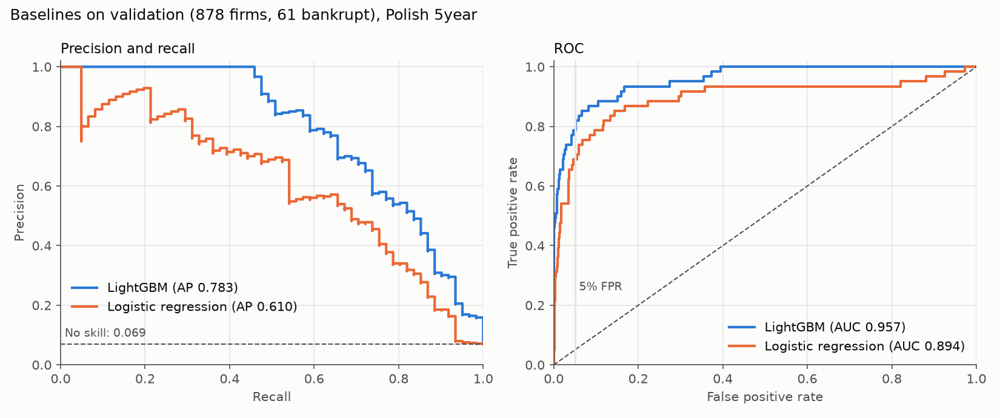

# Phase 2: baselines on validation

Polish 5year, 1-year horizon. Train 4,094 firms (286 bankrupt), validation 878 firms (61 bankrupt).
The test split was not read. Seed 42 everywhere. Raw numbers: [baselines_val.json](baselines_val.json).

## Results

| Metric (validation) | Logistic regression | LightGBM |
|---|---|---|
| PR AUC (no skill = 0.069) | 0.610 (95% CI 0.499 to 0.734) | **0.783** (0.697 to 0.863) |
| ROC AUC | 0.894 (0.831 to 0.945) | **0.957** (0.931 to 0.978) |
| Brier score (lower is better) | 0.0411 | **0.0306** |
| Recall at 5% FPR | 0.689 (42 of 61) | **0.787** (48 of 61) |
| Precision at 5% FPR | 0.512 | **0.545** |
| Recall at 10% FPR | 0.787 | **0.869** |

5-fold stratified cross-validation on train (mean and std) agrees with validation:

| Metric (train CV) | Logistic regression | LightGBM |
|---|---|---|
| PR AUC | 0.691 +/- 0.051 | 0.804 +/- 0.033 |
| ROC AUC | 0.900 +/- 0.024 | 0.960 +/- 0.011 |
| Recall at 5% FPR | 0.706 +/- 0.057 | 0.811 +/- 0.039 |

**The LightGBM lead is real at this sample size.** Paired stratified bootstrap (2,000 resamples) of the
validation PR AUC difference, LightGBM minus logistic regression: +0.169, 95% CI +0.080 to +0.265,
no resample at or below zero. ROC AUC difference: +0.062, CI +0.015 to +0.120.

## Setup

- **Logistic regression:** `build_preprocessor()` (clip to train 1st and 99th percentile, median impute with
  missing indicators, standard scaling), then L2 logistic regression, C = 1.0.
- **LightGBM:** raw ratios, native NaN handling. 300 trees, learning rate 0.05, 15 leaves, min 20 samples per leaf,
  row and column subsampling 0.8, deterministic single-thread training.
- No class reweighting, no hyperparameter tuning, no early stopping (that would leak validation into training).

## What the models rely on

**LightGBM** (share of total gain): `operating_profit_to_fin_expenses` (Attr27) 19.0%, `sales_growth` (Attr21) 18.9%,
`quick_ratio` 5.0%, `opex_to_liabilities` 4.4%, `gp_3y_to_assets` 4.0%. Gain importance is a rough guide; SHAP comes later.

Ablations on validation PR AUC (retrained on train each time):

| Variant | PR AUC |
|---|---|
| All features | 0.783 |
| Attr27 missing values filled with train median | 0.758 |
| Attr27 dropped | 0.620 |
| Attr21 dropped | 0.687 |

So the Attr27 signal is mostly in its values. Its missingness adds a little (0.025), which partly answers Phase 1 flag 8.

**Logistic regression** puts three missing indicators in its ten largest coefficients and gives opposite signs to
near-collinear pairs (for example `sales_to_short_term_liabilities` -1.45 vs `opex_to_short_term_liabilities` +1.42).
Its coefficients should not be read as feature effects.

## Flags

1. **Validation is small.** 61 bankrupt firms; one firm moves recall by 1.6 points. Use the CIs, not the point values.
2. **Attr21 `sales_growth` needs last year's sales.** It is the second strongest feature. A product user must supply two
   years of sales, or the model must cope with it missing (1.8% missing in train).
3. **Attr27 is undefined when financial expenses are zero.** Missing there is likely "no debt cost", not unknown. Same caveat
   as Phase 1 flag 7 for Attr37.
4. **Random split, no time ordering.** These scores do not show how the model holds up on later years.
5. **Probabilities are not calibrated yet.** Brier is low partly because 93% of firms are healthy; reliability curves are a later step.
