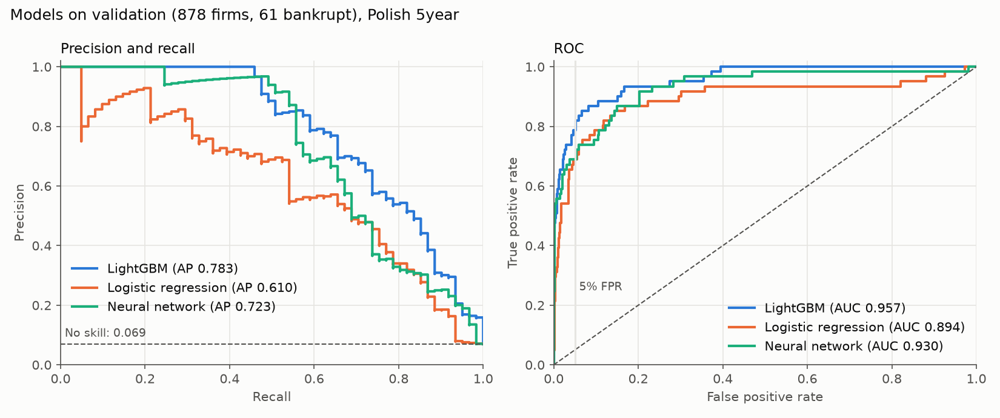

# Models on validation (Phases 2 and 3)

Polish 5year, 1-year horizon. Train 4,094 firms (286 bankrupt), validation 878 firms (61 bankrupt).
The test split was not read. Seed 42 everywhere. Raw numbers: [models_val.json](models_val.json).

## Phase 2: baselines

| Metric (validation) | Logistic regression | LightGBM |
|---|---|---|
| PR AUC (no skill = 0.069) | 0.610 (95% CI 0.499 to 0.734) | **0.783** (0.697 to 0.863) |
| ROC AUC | 0.894 (0.831 to 0.945) | **0.957** (0.931 to 0.978) |
| Brier score (lower is better) | 0.0411 | **0.0306** |
| Recall at 5% FPR | 0.689 (42 of 61) | **0.787** (48 of 61) |
| Precision at 5% FPR | 0.512 | **0.545** |
| Recall at 10% FPR | 0.787 | **0.869** |

5-fold stratified cross-validation on train (mean and std) agrees with validation:

| Metric (train CV) | Logistic regression | LightGBM |
|---|---|---|
| PR AUC | 0.691 +/- 0.051 | 0.804 +/- 0.033 |
| ROC AUC | 0.900 +/- 0.024 | 0.960 +/- 0.011 |
| Recall at 5% FPR | 0.706 +/- 0.057 | 0.811 +/- 0.039 |

**The LightGBM lead is real at this sample size.** Paired stratified bootstrap (2,000 resamples) of the
validation PR AUC difference, LightGBM minus logistic regression: +0.169, 95% CI +0.080 to +0.265,
no resample at or below zero. ROC AUC difference: +0.062, CI +0.015 to +0.120.

## Phase 3: neural network

### Results

| Metric (validation) | Logistic regression | Neural network | LightGBM |
|---|---|---|---|
| PR AUC (no skill = 0.069) | 0.610 (0.499 to 0.734) | 0.723 (0.621 to 0.821) | **0.783** (0.697 to 0.863) |
| ROC AUC | 0.894 | 0.930 (0.886 to 0.964) | **0.957** |
| Brier score | 0.0411 | 0.0321 | **0.0306** |
| Recall at 5% FPR | 0.689 (42 of 61) | 0.689 (42 of 61) | **0.787** (48 of 61) |
| Precision at 5% FPR | 0.512 | 0.512 | **0.545** |
| Recall at 10% FPR | 0.787 | 0.754 | **0.869** |
| Train CV PR AUC | 0.691 +/- 0.051 | 0.758 +/- 0.044 | **0.804** +/- 0.033 |

Paired stratified bootstrap on validation (2,000 resamples), neural network minus each baseline:

| Comparison | PR AUC difference (95% CI) | ROC AUC difference (95% CI) |
|---|---|---|
| vs logistic regression | +0.112 (+0.027 to +0.196) | +0.036 (+0.002 to +0.076) |
| vs LightGBM | -0.060 (-0.124 to -0.001) | -0.027 (-0.066 to +0.003) |

**Verdict:** the network clearly beats logistic regression and trails LightGBM. The PR AUC gap to LightGBM
is borderline at this sample size (CI upper bound -0.001), and train CV shows the same order.
On these 64 tabular ratios, gradient boosted trees are the stronger model so far.

### Architecture and training

- `TremorNet` in `src/nn.py`: MLP 112 inputs (64 features plus 48 missing indicators), hidden layers 64 and 32, ReLU, dropout 0.2, one logit.
- Inputs: median imputation with missing indicators, then a rank based map to a normal distribution (`QuantileTransformer`).
- AdamW, learning rate 1e-3, weight decay 1e-4, batch 128, binary cross-entropy without class weights.
- Early stopping on an inner stratified 15% holdout from train (patience 25, best weights restored). The final model stopped at epoch 45 of 70.
- CPU, one thread, deterministic algorithms, seed 42. Two fits give identical predictions (tested).

### How the configuration was chosen (train CV only)

Validation was not used to pick anything. Each variant was scored by 5-fold stratified CV on train:

| Variant | CV PR AUC | CV ROC AUC |
|---|---|---|
| A: clip and standard scale (shared preprocessor) | 0.709 +/- 0.049 | 0.926 |
| **B: quantile scaling** (chosen) | 0.758 +/- 0.044 | 0.940 |
| C: A with learning rate 3e-4, patience 60 | 0.713 +/- 0.047 | 0.926 |
| D: B with learning rate 3e-4, patience 60 | 0.765 +/- 0.048 | 0.942 |
| E: D with layers 128 and 64, dropout 0.3 | 0.766 +/- 0.050 | 0.945 |

Rule: the simplest variant within 0.01 of the best CV PR AUC, so B. Differences among B, D and E are far inside one fold standard deviation.

Variant A was also scored on validation before this search (PR AUC 0.625, stopped at epoch 9). That run is reported
for transparency; it did not inform the choice, which used train CV only.

Fairness check: logistic regression with the same quantile scaling gains only 0.014 in CV PR AUC (0.691 to 0.705),
so most of the network's gain comes from its nonlinearity, not the scaling alone. The reported logistic regression keeps its Phase 2 setup.

### Phase 3 flags

1. **The baselines got no tuning; the network got a five-variant search.** The comparison slightly favours the network, and it still trails LightGBM.
2. **Ranks agree only partly with LightGBM** (Spearman 0.80 on validation). As a diagnostic only, a plain average of the two scores PR AUC 0.784,
   no better than LightGBM alone. Not adopted.
3. **Early stopping is noisy.** The inner holdout holds about 43 bankrupt firms, so the stopping epoch can move a lot with small changes.
4. All Phase 2 flags still apply (small validation set, random split, Attr21 needs prior year sales, uncalibrated probabilities).

## Phase 2 details

### Setup

- **Logistic regression:** `build_preprocessor()` (clip to train 1st and 99th percentile, median impute with
  missing indicators, standard scaling), then L2 logistic regression, C = 1.0.
- **LightGBM:** raw ratios, native NaN handling. 300 trees, learning rate 0.05, 15 leaves, min 20 samples per leaf,
  row and column subsampling 0.8, deterministic single-thread training.
- No class reweighting, no hyperparameter tuning, no early stopping (that would leak validation into training).

### What the baselines rely on

**LightGBM** (share of total gain): `operating_profit_to_fin_expenses` (Attr27) 19.0%, `sales_growth` (Attr21) 18.9%,
`quick_ratio` 5.0%, `opex_to_liabilities` 4.4%, `gp_3y_to_assets` 4.0%. Gain importance is a rough guide; SHAP comes later.

Ablations on validation PR AUC (retrained on train each time):

| Variant | PR AUC |
|---|---|
| All features | 0.783 |
| Attr27 missing values filled with train median | 0.758 |
| Attr27 dropped | 0.620 |
| Attr21 dropped | 0.687 |

So the Attr27 signal is mostly in its values. Its missingness adds a little (0.025), which partly answers Phase 1 flag 8.

**Logistic regression** puts three missing indicators in its ten largest coefficients and gives opposite signs to
near-collinear pairs (for example `sales_to_short_term_liabilities` -1.45 vs `opex_to_short_term_liabilities` +1.42).
Its coefficients should not be read as feature effects.

### Phase 2 flags

1. **Validation is small.** 61 bankrupt firms; one firm moves recall by 1.6 points. Use the CIs, not the point values.
2. **Attr21 `sales_growth` needs last year's sales.** It is the second strongest feature. A product user must supply two
   years of sales, or the model must cope with it missing (1.8% missing in train).
3. **Attr27 is undefined when financial expenses are zero.** Missing there is likely "no debt cost", not unknown. Same caveat
   as Phase 1 flag 7 for Attr37.
4. **Random split, no time ordering.** These scores do not show how the model holds up on later years.
5. **Probabilities are not calibrated yet.** Brier is low partly because 93% of firms are healthy; reliability curves are a later step.
