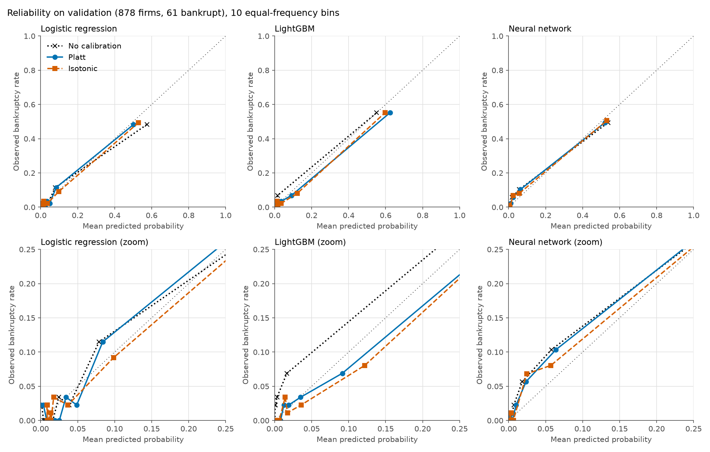
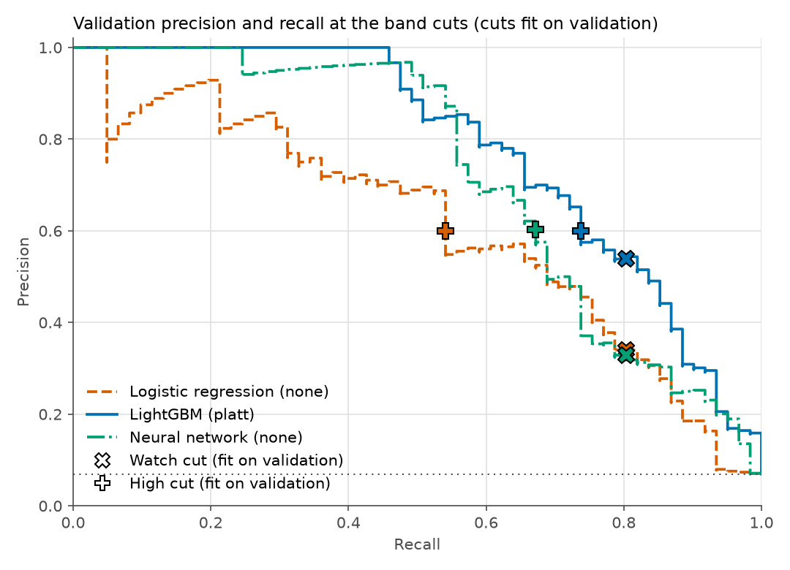

# Phase 4: calibration, thresholds and risk bands

Polish 5year, 1-year horizon. Train 4,094 firms (286 bankrupt), validation 878 (61 bankrupt, no-skill PR AUC 0.069). The test split was not read. Seed 42. Every number below is generated by `python -m scripts.run_phase4`; raw values are in [phase4_calibration.json](phase4_calibration.json).

## Method and the choices made

- **Calibration data: 5-fold out-of-fold (OOF) predictions on train.** Each firm is scored by a model that never saw it, and all 286 train positives are used. The alternative, a calibration split carved from train, would leave about 86 positives (at 30%), too few for isotonic regression, which needs many points per step. Cross-fitting costs one thing: the saved models are refit on all of train, so they differ slightly from the fold models the calibrators were fitted on.
- **Validation is never used to fit a calibrator or choose a threshold.** It only reports. The calibration method per model is also chosen on train OOF (below), not on validation.
- **Methods:** none, Platt (sigmoid on the logit of the score) and isotonic (monotone steps).
- **Method rule, set before results:** lowest cross-validated log loss on the OOF scores, ties within one standard error resolved toward the simpler method (none, Platt, isotonic).
- **ECE:** 10 equal-frequency bins (equal-width bins would be mostly empty at a 7% base rate). Log loss clips probabilities to [0.0001, 1 - 0.0001]. Bootstrap CIs: 1000 stratified resamples of validation, percentile 95%.

## Calibration method chosen on train (cross-validated, OOF)

| Model | none log loss (SE) | platt log loss (SE) | isotonic log loss (SE) | Chosen |
|---|---|---|---|---|
| Logistic regression | 0.1447 (0.0073) | 0.1435 (0.0058) | 0.1420 (0.0061) | **none** |
| LightGBM | 0.1291 (0.0106) | 0.1029 (0.0056) | 0.1070 (0.0071) | **platt** |
| Neural network | 0.1183 (0.0058) | 0.1189 (0.0051) | 0.1207 (0.0064) | **none** |

## Validation: before and after calibration

Lower is better for Brier, log loss and ECE. PR AUC is higher-better; Platt cannot change ranking, so any PR AUC change comes from ties (isotonic).

| Model | Method | Brier (95% CI) | Log loss | ECE | PR AUC |
|---|---|---|---|---|---|
| Logistic regression | none (chosen) | 0.0411 (0.0321 to 0.0505) | 0.1733 (0.1315 to 0.2247) | 0.0235 (0.0113 to 0.0349) | 0.610 (0.499 to 0.734) |
| Logistic regression | platt | 0.0404 (0.0323 to 0.0490) | 0.1645 (0.1302 to 0.2058) | 0.0184 (0.0132 to 0.0306) | 0.610 (0.499 to 0.734) |
| Logistic regression | isotonic | 0.0407 (0.0325 to 0.0494) | 0.1637 (0.1275 to 0.2074) | 0.0138 (0.0113 to 0.0325) | 0.579 (0.461 to 0.700) |
| LightGBM | none | 0.0306 (0.0227 to 0.0387) | 0.1257 (0.0887 to 0.1664) | 0.0128 (0.0092 to 0.0261) | 0.783 (0.697 to 0.863) |
| LightGBM | platt (chosen) | 0.0300 (0.0230 to 0.0374) | 0.1088 (0.0854 to 0.1332) | 0.0132 (0.0083 to 0.0271) | 0.783 (0.697 to 0.863) |
| LightGBM | isotonic | 0.0286 (0.0223 to 0.0350) | 0.1033 (0.0825 to 0.1262) | 0.0138 (0.0089 to 0.0272) | 0.767 (0.676 to 0.847) |
| Neural network | none (chosen) | 0.0321 (0.0241 to 0.0403) | 0.1320 (0.0959 to 0.1716) | 0.0168 (0.0080 to 0.0282) | 0.723 (0.621 to 0.821) |
| Neural network | platt | 0.0317 (0.0240 to 0.0399) | 0.1282 (0.0945 to 0.1658) | 0.0140 (0.0073 to 0.0254) | 0.723 (0.621 to 0.821) |
| Neural network | isotonic | 0.0319 (0.0239 to 0.0404) | 0.1316 (0.0974 to 0.1698) | 0.0138 (0.0114 to 0.0336) | 0.696 (0.592 to 0.792) |

Paired bootstrap, change from calibrating (method minus none), 95% CI:

| Model | Method | Brier | Log loss | ECE | PR AUC |
|---|---|---|---|---|---|
| Logistic regression | platt | -0.0008 (-0.0026 to +0.0009) | -0.0087 (-0.0196 to -0.0001) | -0.0051 (-0.0067 to +0.0099) | +0.000 (-0.000 to +0.000) |
| Logistic regression | isotonic | -0.0004 (-0.0020 to +0.0010) | -0.0096 (-0.0305 to +0.0100) | -0.0098 (-0.0088 to +0.0069) | -0.031 (-0.060 to -0.006) |
| LightGBM | platt | -0.0005 (-0.0026 to +0.0015) | -0.0170 (-0.0344 to -0.0015) | +0.0005 (-0.0123 to +0.0101) | +0.000 (+0.000 to +0.000) |
| LightGBM | isotonic | -0.0020 (-0.0047 to +0.0005) | -0.0224 (-0.0411 to -0.0051) | +0.0011 (-0.0105 to +0.0109) | -0.016 (-0.024 to -0.010) |
| Neural network | platt | -0.0004 (-0.0009 to +0.0001) | -0.0037 (-0.0070 to -0.0006) | -0.0028 (-0.0033 to +0.0011) | +0.000 (-0.000 to +0.000) |
| Neural network | isotonic | -0.0002 (-0.0010 to +0.0006) | -0.0003 (-0.0065 to +0.0049) | -0.0030 (-0.0012 to +0.0115) | -0.026 (-0.040 to -0.014) |

Platt fit on OOF train: Logistic regression slope 0.779, intercept -0.469; LightGBM slope 0.648, intercept 0.416; Neural network slope 0.881, intercept -0.215. A slope below 1 means the raw model was overconfident. Isotonic knots: Logistic regression 44; LightGBM 50; Neural network 38.

## Risk bands

**Rule, fixed before this run (docs/decisions.md).** The first rule (OOF precision 0.25, OOF recall 0.80) degenerated, with an empty Watch band, and the user replaced it. On the calibrated probability of the chosen method, **fitted on validation**: Watch is the highest threshold at which recall is still at least 0.80. High is the lowest threshold at which precision is at least 0.60. If the Watch cut is not below the High cut there are only two bands, Low and High, and no Watch band is forced.

Caveats: the cuts are fitted on the same validation split they are reported on, so the validation columns below are in-sample and optimistic (61 positives). The train OOF columns apply the same cuts to firms that played no part in setting them, so they are the independent check. The 0.60 floor was chosen after an earlier diagnostic had been seen, so it is not a blind choice.

| Model | Method | Bands | Watch cut (p >=) | High cut (p >=) |
|---|---|---|---|---|
| Logistic regression | none | three | 0.0614 | 0.3629 |
| LightGBM | platt | three | 0.1736 | 0.2403 |
| Neural network | none | three | 0.0399 | 0.1877 |

### LightGBM (headline), platt

| Band | Val firms (in-sample) | Val bankrupt | Val bankrupt rate | Val share of all bankrupt | Train OOF firms (independent) | OOF bankrupt rate | OOF share of all bankrupt |
|---|---|---|---|---|---|---|---|
| Low | 787 (89.6%) | 12 | 0.015 | 19.7% | 3735 (91.2%) | 0.018 | 23.1% |
| Watch | 16 (1.8%) | 4 | 0.250 | 6.6% | 52 (1.3%) | 0.231 | 4.2% |
| High | 75 (8.5%) | 45 | 0.600 | 73.8% | 307 (7.5%) | 0.678 | 72.7% |

### Logistic regression (comparison, not deployed), none

| Band | Val firms (in-sample) | Val bankrupt | Val bankrupt rate | Val share of all bankrupt | Train OOF firms (independent) | OOF bankrupt rate | OOF share of all bankrupt |
|---|---|---|---|---|---|---|---|
| Low | 734 (83.6%) | 12 | 0.016 | 19.7% | 3444 (84.1%) | 0.017 | 20.3% |
| Watch | 89 (10.1%) | 16 | 0.180 | 26.2% | 415 (10.1%) | 0.152 | 22.0% |
| High | 55 (6.3%) | 33 | 0.600 | 54.1% | 235 (5.7%) | 0.702 | 57.7% |

### Neural network (comparison, not deployed), none

| Band | Val firms (in-sample) | Val bankrupt | Val bankrupt rate | Val share of all bankrupt | Train OOF firms (independent) | OOF bankrupt rate | OOF share of all bankrupt |
|---|---|---|---|---|---|---|---|
| Low | 729 (83.0%) | 12 | 0.016 | 19.7% | 3217 (78.6%) | 0.010 | 11.5% |
| Watch | 81 (9.2%) | 8 | 0.099 | 13.1% | 515 (12.6%) | 0.087 | 15.7% |
| High | 68 (7.7%) | 41 | 0.603 | 67.2% | 362 (8.8%) | 0.575 | 72.7% |

### What each precision floor implies (validation, chosen method)

For the lowest threshold meeting each precision floor: the recall reached and the share of firms flagged. This shows how sensitive the High cut is to the floor.

| Model | Floor 0.25: recall / firms flagged | Floor 0.35: recall / firms flagged | Floor 0.50: recall / firms flagged | Floor 0.60: recall / firms flagged | Floor 0.70: recall / firms flagged |
|---|---|---|---|---|---|
| Logistic regression | 0.869 / 24.1% | 0.787 / 15.6% | 0.689 / 9.6% | 0.541 / 6.3% | 0.475 / 4.7% |
| LightGBM | 0.934 / 26.0% | 0.885 / 17.5% | 0.836 / 11.6% | 0.738 / 8.5% | 0.689 / 6.8% |
| Neural network | 0.918 / 25.5% | 0.787 / 15.6% | 0.721 / 10.0% | 0.672 / 7.7% | 0.590 / 5.8% |

### Precision-recall tradeoff (calibrated probability cutoffs, chosen method)

Cutoffs are fixed in advance on a probability grid, not tuned. Full grid for every model in [phase4_pr_tradeoff.csv](phase4_pr_tradeoff.csv).

**Logistic regression** (validation; OOF train in the CSV)

| Cutoff | Firms flagged | Precision | Recall |
|---|---|---|---|
| 0.010 | 509 (58.0%) | 0.112 | 0.934 |
| 0.020 | 349 (39.7%) | 0.163 | 0.934 |
| 0.030 | 263 (30.0%) | 0.205 | 0.885 |
| 0.050 | 176 (20.0%) | 0.295 | 0.852 |
| 0.075 | 121 (13.8%) | 0.388 | 0.770 |
| 0.100 | 107 (12.2%) | 0.430 | 0.754 |
| 0.150 | 88 (10.0%) | 0.489 | 0.705 |
| 0.200 | 81 (9.2%) | 0.519 | 0.689 |
| 0.250 | 69 (7.9%) | 0.565 | 0.639 |
| 0.300 | 63 (7.2%) | 0.556 | 0.574 |
| 0.400 | 52 (5.9%) | 0.635 | 0.541 |
| 0.500 | 46 (5.2%) | 0.696 | 0.525 |
| 0.600 | 41 (4.7%) | 0.707 | 0.475 |
| 0.700 | 32 (3.6%) | 0.719 | 0.377 |
| 0.800 | 26 (3.0%) | 0.769 | 0.328 |
| 0.900 | 22 (2.5%) | 0.818 | 0.295 |

**LightGBM** (validation; OOF train in the CSV)

| Cutoff | Firms flagged | Precision | Recall |
|---|---|---|---|
| 0.010 | 435 (49.5%) | 0.140 | 1.000 |
| 0.020 | 291 (33.1%) | 0.199 | 0.951 |
| 0.030 | 240 (27.3%) | 0.237 | 0.934 |
| 0.050 | 176 (20.0%) | 0.307 | 0.885 |
| 0.075 | 133 (15.1%) | 0.398 | 0.869 |
| 0.100 | 116 (13.2%) | 0.448 | 0.852 |
| 0.150 | 95 (10.8%) | 0.526 | 0.820 |
| 0.200 | 80 (9.1%) | 0.575 | 0.754 |
| 0.250 | 74 (8.4%) | 0.608 | 0.738 |
| 0.300 | 71 (8.1%) | 0.634 | 0.738 |
| 0.400 | 62 (7.1%) | 0.694 | 0.705 |
| 0.500 | 52 (5.9%) | 0.769 | 0.656 |
| 0.600 | 46 (5.2%) | 0.783 | 0.590 |
| 0.700 | 38 (4.3%) | 0.842 | 0.525 |
| 0.800 | 29 (3.3%) | 0.966 | 0.459 |
| 0.900 | 25 (2.8%) | 1.000 | 0.410 |

**Neural network** (validation; OOF train in the CSV)

| Cutoff | Firms flagged | Precision | Recall |
|---|---|---|---|
| 0.010 | 264 (30.1%) | 0.216 | 0.934 |
| 0.020 | 203 (23.1%) | 0.261 | 0.869 |
| 0.030 | 179 (20.4%) | 0.296 | 0.869 |
| 0.050 | 128 (14.6%) | 0.359 | 0.754 |
| 0.075 | 105 (12.0%) | 0.429 | 0.738 |
| 0.100 | 97 (11.0%) | 0.464 | 0.738 |
| 0.150 | 78 (8.9%) | 0.538 | 0.689 |
| 0.200 | 63 (7.2%) | 0.635 | 0.656 |
| 0.250 | 56 (6.4%) | 0.696 | 0.639 |
| 0.300 | 48 (5.5%) | 0.729 | 0.574 |
| 0.400 | 43 (4.9%) | 0.791 | 0.557 |
| 0.500 | 40 (4.6%) | 0.850 | 0.557 |
| 0.600 | 36 (4.1%) | 0.917 | 0.541 |
| 0.700 | 33 (3.8%) | 0.939 | 0.508 |
| 0.800 | 31 (3.5%) | 0.968 | 0.492 |
| 0.900 | 30 (3.4%) | 0.967 | 0.475 |

## Cost framing (assumptions)

Cost = ratio x missed distress + 1 x false alarm. The ratios 5:1, 10:1 and 20:1 are **assumptions**, not estimates. The empirical cut minimises cost on OOF train; the theoretical cut 1 / (1 + ratio) is optimal only if the probabilities are perfectly calibrated. Both are scored on validation as cost per 1,000 firms; for reference, flagging nobody and flagging everybody cost the amounts in the last two columns.

**Logistic regression** (none)

| Ratio | Theory cut | Theory: flagged / recall / precision / cost | Empirical cut | Empirical: flagged / recall / precision / cost | Flag nobody | Flag everybody |
|---|---|---|---|---|---|---|
| 5:1 | 0.167 | 86 / 0.689 / 0.488 / 158 | 0.2235 | 78 / 0.672 / 0.526 / 156 | 347 | 931 |
| 10:1 | 0.091 | 111 / 0.754 / 0.414 / 245 | 0.0669 | 136 / 0.787 / 0.353 / 248 | 695 | 931 |
| 20:1 | 0.048 | 184 / 0.852 / 0.283 / 355 | 0.0444 | 197 / 0.869 / 0.269 / 346 | 1390 | 931 |

**LightGBM** (platt)

| Ratio | Theory cut | Theory: flagged / recall / precision / cost | Empirical cut | Empirical: flagged / recall / precision / cost | Flag nobody | Flag everybody |
|---|---|---|---|---|---|---|
| 5:1 | 0.167 | 91 / 0.803 / 0.538 / 116 | 0.1271 | 104 / 0.836 / 0.490 / 117 | 347 | 931 |
| 10:1 | 0.091 | 122 / 0.869 / 0.434 / 170 | 0.0854 | 128 / 0.869 / 0.414 / 177 | 695 | 931 |
| 20:1 | 0.048 | 181 / 0.902 / 0.304 / 280 | 0.0375 | 203 / 0.934 / 0.281 / 257 | 1390 | 931 |

**Neural network** (none)

| Ratio | Theory cut | Theory: flagged / recall / precision / cost | Empirical cut | Empirical: flagged / recall / precision / cost | Flag nobody | Flag everybody |
|---|---|---|---|---|---|---|
| 5:1 | 0.167 | 73 / 0.689 / 0.575 / 144 | 0.1682 | 73 / 0.689 / 0.575 / 144 | 347 | 931 |
| 10:1 | 0.091 | 100 / 0.738 / 0.450 / 245 | 0.0790 | 102 / 0.738 / 0.441 / 247 | 695 | 931 |
| 20:1 | 0.048 | 134 / 0.770 / 0.351 / 418 | 0.0545 | 121 / 0.738 / 0.372 / 451 | 1390 | 931 |

## Model decision (recorded)

Validation comparison with the chosen calibration per model (bands as defined above):

| Model | Method | PR AUC (95% CI) | Brier | Log loss | ECE | Watch+High recall | High precision |
|---|---|---|---|---|---|---|---|
| Logistic regression | none | 0.610 (0.499 to 0.734) | 0.0411 | 0.1733 | 0.0235 | 0.803 | 0.600 |
| LightGBM | platt | 0.783 (0.697 to 0.863) | 0.0300 | 0.1088 | 0.0132 | 0.803 | 0.600 |
| Neural network | none | 0.723 (0.621 to 0.821) | 0.0321 | 0.1320 | 0.0168 | 0.803 | 0.603 |

**Decision (user, 2026-10-17): headline model is LightGBM with platt calibration. The neural network stays in the repo as the deep learning comparison and is not deployed.**

- On validation LightGBM has PR AUC 0.783 vs 0.723 for the neural network, Brier 0.0300 vs 0.0321 and log loss 0.1088 vs 0.1320.
- Platt changes its validation log loss by -0.0170 (95% CI -0.0344 to -0.0015). Raw LightGBM scores are not probabilities.

**Risks that stay open:**
1. The PR AUC lead over the neural network is borderline at this sample size (61 validation positives; the Phase 3 paired CI upper bound was just below zero).
2. It relies heavily on `sales_growth` (Attr21, needs last year's sales) and `Attr27` (undefined when financial expenses are zero), see the Phase 2 flags.
3. Its Platt calibration is a real correction (slope 0.65), fitted on fold models, not on the saved model, so some mismatch is possible.
4. The band cuts are fitted on the same validation split they are reported on (see Risk bands).
5. Random split, no time ordering, so performance on future years may be lower.

## Flags

1. Validation has only 61 bankrupt firms and ECE uses 10 equal-frequency bins of about 87 firms (about 6 positives each), so ECE and the reliability points are noisy. Read them with the CIs.
2. Calibrators and bands were fitted on 5-fold out-of-fold scores of the train split (286 bankrupt). The saved models are refit on all of train, so they are slightly stronger than the fold models the calibrators saw. Direction of the bias is not verified.
3. Cost ratios 5:1, 10:1 and 20:1 are assumptions, not estimates from any lender or data.
4. Band cuts are fitted on validation by user instruction, so validation precision and recall at the cuts are in-sample and optimistic. The independent check is the same cuts applied to train out-of-fold scores.
5. The High precision floor 0.60 was set after an earlier precision-floor diagnostic and the validation tradeoff table had been seen, so it is not a blind choice.
6. logistic_regression: recall of the flagged bands on train OOF (0.797) is below the 0.80 target the cut reached on validation.
7. logistic_regression: isotonic gives exactly 0 or 1 to 19 validation firms (log loss clips at 0.0001), which is overconfident and costs log loss.
8. lightgbm: recall of the flagged bands on train OOF (0.769) is below the 0.80 target the cut reached on validation.
9. lightgbm: the Watch band is thin (16 validation firms with 4 bankrupt, 52 train OOF firms), because the 80% recall cut (0.1736) and the precision cut (0.2403) are close. Its rate rests on very few positives.
10. lightgbm: isotonic gives exactly 0 or 1 to 151 validation firms (log loss clips at 0.0001), which is overconfident and costs log loss.
11. neural_net: High-band precision on train OOF (0.575) is below the 0.60 floor the cut reached on validation.
12. neural_net: isotonic gives exactly 0 or 1 to 33 validation firms (log loss clips at 0.0001), which is overconfident and costs log loss.
