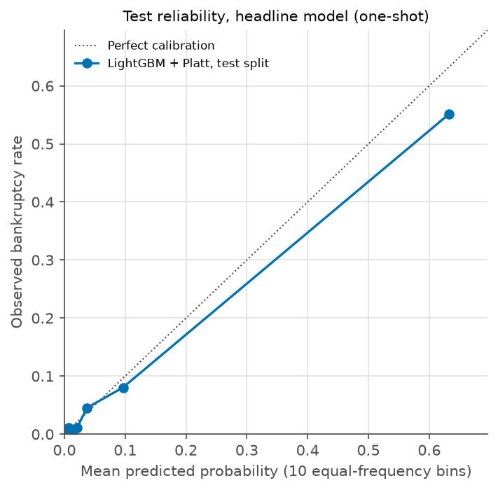

# Phase 5: final test evaluation (one shot)

Generated by scripts/final_test_eval.py. Split: **test**. 878 firms, 61 bankrupt. Seed 42, 1000 stratified bootstrap resamples.
Headline: lightgbm with platt calibration, cuts Watch 0.1736 and High 0.2403, frozen at commit fdef552. Nothing was retrained, recalibrated or re-cut.

## Verdict rule result: HOLDS UP on the pre-stated rule

The rule was fixed before the run (docs/decisions.md, Phase 5 protocol).

- (a) the test PR AUC point estimate lies inside the validation 95% CI of the headline model: **pass** (test 0.797, validation CI 0.697 to 0.863)
- (b) the lower bound of the test PR AUC 95% CI is above the prevalence baseline: **pass** (lower bound 0.712, baseline 0.069)
- (c) the 95% CI of High-band precision on test contains the 0.60 precision floor: **pass** (High precision CI 0.518 to 0.700, floor 0.60)

## Test next to validation and train out-of-fold (headline model)

| Metric | Train OOF (independent of cuts) | Validation (cuts fitted here) | Test (one shot) |
|---|---|---|---|
| Firms, bankrupt | 4094, 286 | 878, 61 | 878, 61 |
| Prevalence (PR AUC baseline) | 0.070 | 0.069 | 0.069 |
| PR AUC (95% CI) | 0.800 | 0.783 (0.697 to 0.863) | 0.797 (0.712 to 0.872) |
| ROC AUC (95% CI) | not saved in Phase 4 | 0.957 (0.931 to 0.978) | 0.956 (0.926 to 0.978) |
| Brier (95% CI) | 0.0277 | 0.0300 (0.0230 to 0.0374) | 0.0280 (0.0212 to 0.0360) |
| Log loss (95% CI) | 0.1024 | 0.1088 (0.0854 to 0.1332) | 0.1057 (0.0834 to 0.1318) |
| ECE, 10 bins (95% CI) | 0.0049 | 0.0132 (0.0083 to 0.0271) | 0.0152 (0.0101 to 0.0286) |
| Mean predicted probability | 0.0699 | 0.0799 | 0.0821 |
| Watch band: firms, bankrupt, rate | 52, 12, 0.231 | 16, 4, 0.250 | 16, 3, 0.188 |
| High band: firms, bankrupt, rate | 307, 208, 0.678 | 75, 45, 0.600 | 76, 46, 0.605 |
| Low band: firms, bankrupt, rate | 3735, 66, 0.018 | 787, 12, 0.015 | 786, 12, 0.015 |
| High alone: precision (95% CI) | 0.678 | 0.600 | 0.605 (0.518 to 0.700) |
| High alone: recall (95% CI) | 0.727 | 0.738 | 0.754 (0.639 to 0.852) |
| Watch+High: precision (95% CI) | 0.613 | 0.538 | 0.533 (0.462 to 0.617) |
| Watch+High: recall (95% CI) | 0.769 | 0.803 | 0.803 (0.705 to 0.902) |

Which gaps are expected optimism (stated before the run):

- Validation band cuts: fitted on validation, so validation precision and recall at the cuts are in-sample and optimistic.
- Validation model choice: LightGBM was picked over two other models using validation, so its validation PR AUC is mildly optimistic (winner's curse).
- Train OOF calibration metrics: the Platt calibrator was fitted on those same OOF scores, so OOF Brier, log loss and ECE are in-sample for a two-parameter map (mildly optimistic).
- Train OOF model strength: OOF scores come from models trained on 80% of train, so they understate the refit model slightly.
- Test: no part of the model, calibrator or cuts saw it. A gap from validation in the direction of these optimism sources is expected. A gap the other way, or a much larger one, is not explained by them.

## Confusion matrix at the High cut (test)

| | Actually bankrupt | Actually healthy |
|---|---|---|
| Flagged High | 46 (true positives) | 30 (false alarms) |
| Not High | 15 (missed) | 787 (true negatives) |

## Reference models (deep learning and linear comparison, not eligible to replace the headline)

| Model (calibration) | Split | PR AUC | ROC AUC | Brier | Log loss | ECE | Watch cut | High cut | High precision | Watch+High recall |
|---|---|---|---|---|---|---|---|---|---|---|
| logistic_regression (none) | validation | 0.610 | 0.894 | 0.0411 | 0.1733 | 0.0235 | 0.0614 | 0.3629 | 0.600 | 0.803 |
| logistic_regression (none) | test | 0.732 (0.630 to 0.827) | 0.912 (0.861 to 0.956) | 0.0318 | 0.1306 | 0.0150 | 0.0614 | 0.3629 | 0.722 | 0.820 |
| neural_net (none) | validation | 0.723 | 0.930 | 0.0321 | 0.1320 | 0.0168 | 0.0399 | 0.1877 | 0.603 | 0.803 |
| neural_net (none) | test | 0.803 (0.714 to 0.887) | 0.936 (0.888 to 0.972) | 0.0249 | 0.1102 | 0.0079 | 0.0399 | 0.1877 | 0.683 | 0.885 |

## Flags

1. The Watch band is thin on test (16 firms, 3 bankrupt), so its rate carries almost no information. Fewer than 30 firms is the thin-band line.
2. neural_net has a higher test PR AUC (0.803) than the headline model (0.797). The intervals overlap almost completely, so neither model can be called better on this test set. By protocol it is reference only and does not replace the headline; the user may choose to revisit.
3. Change in PR AUC from validation to test: lightgbm +0.014, logistic_regression +0.121, neural_net +0.081. The models do not move together by the same amount, so the validation gaps between the three models should not be over-read.
4. The headline PR AUC is higher on test than on validation. That is the opposite of the expected-optimism direction stated before the run, so the optimism sources do not explain this gap. It is small against the interval width, and the most plausible reading is sampling noise.
5. One test set of 61 bankrupt firms. Every interval is wide, and this is a single draw, not a repeated trial.
6. Random split only, no company id or year, so this says nothing about performance on future years.
7. Calibrators and band cuts were fitted on fold models, while the scored model is refit on all of train. The test run does not isolate this mismatch.
8. Attr21 (sales_growth) needs last year's sales, and it is the second strongest feature.
9. Nothing was retrained, recalibrated or re-cut after seeing these results, by protocol.

## Provenance

- Git HEAD at run: `5d16fa8`. Protocol file SHA256: `1871f58e661fb7953975a552e1260c8ff76aa09e353ad5d0143c6a91964c9204`.
- Test file SHA256 (bytes read once): `c03ae729ccc1426204e7ecde98bf1dfcba6a97ffeb5c4c716b032a8b1d8604a8`.
- Versions: {"python": "3.11.4", "scikit-learn": "1.9.1", "numpy": "2.4.6", "pandas": "3.0.6", "lightgbm": "4.7.0", "torch": "2.14.1", "joblib": "1.6.0"}.
