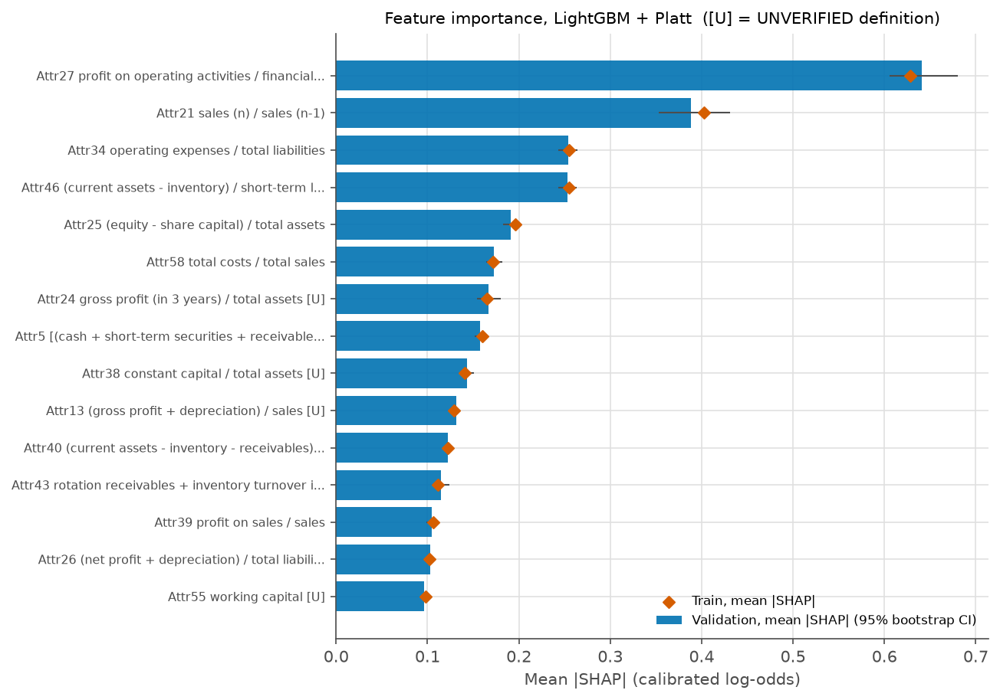
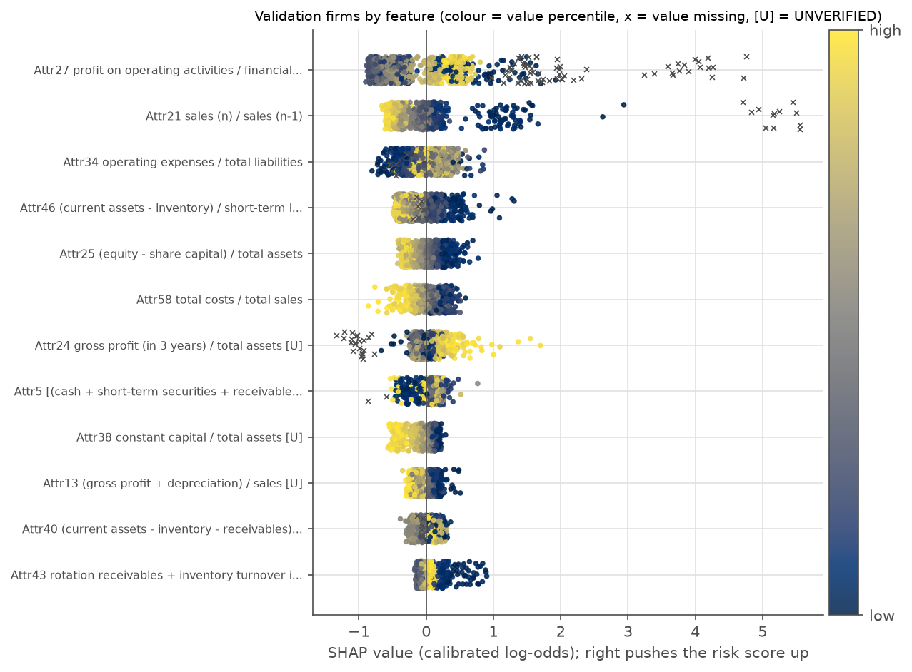
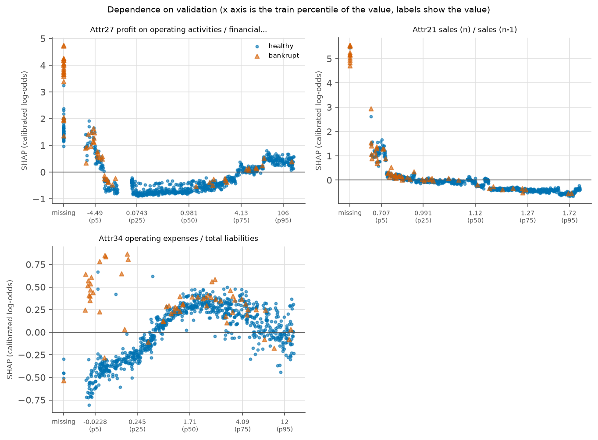
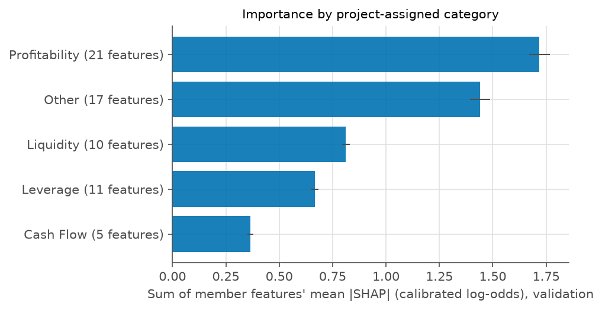

# Phase 6: SHAP explanations (LightGBM + Platt, train and validation only)

Generated by scripts/run_phase6.py. The model, calibrator and cuts are frozen (hash checked). The test split was not read. Seed 42, 1000 stratified bootstrap resamples over validation firms.

## Scale, and the Platt slope check

SHAP values are reported in **calibrated log-odds**. Platt is sigmoid(a * logit(score) + b), so SHAP in raw log-odds converts by multiplying by a = 0.6475 when the calibrator was fitted on raw log-odds. The conversion was verified, not assumed:

| Split | Firms | Max error vs calibrated log-odds | Tolerance | Clipped scores | Passed |
|---|---|---|---|---|---|
| train | 4094 | 2.83e-13 | 1e-06 | 0 | True |
| val | 878 | 6.31e-14 | 1e-06 | 0 | True |

Base value: -4.050 log-odds (probability 0.0171).

## Global importance

Mean absolute SHAP over validation firms, top 15 of 64. Feature names are the UCI formula text with the attribute code. UNVERIFIED marks definitions the dictionary itself flags as possibly mistranslated, unclear or inconsistent.

| Rank (95% CI) | Feature | Category | Mean abs SHAP, validation (95% CI) | Train | Share of total |
|---|---|---|---|---|---|
| 1 (1 to 1) | Attr27: profit on operating activities / financial expenses | Profitability | 0.641 (0.606 to 0.680) | 0.629 | 12.8% |
| 2 (2 to 2) | Attr21: sales (n) / sales (n-1) | Other | 0.389 (0.353 to 0.431) | 0.403 | 7.8% |
| 3 (3 to 4) | Attr34: operating expenses / total liabilities | Other | 0.254 (0.243 to 0.264) | 0.255 | 5.1% |
| 4 (3 to 4) | Attr46: (current assets - inventory) / short-term liabilities | Liquidity | 0.253 (0.243 to 0.263) | 0.254 | 5.1% |
| 5 (5 to 5) | Attr25: (equity - share capital) / total assets | Leverage | 0.191 (0.183 to 0.200) | 0.196 | 3.8% |
| 6 (6 to 7) | Attr58: total costs / total sales | Profitability | 0.173 (0.165 to 0.182) | 0.172 | 3.5% |
| 7 (6 to 8) | Attr24: gross profit (in 3 years) / total assets [UNVERIFIED Attr24: 'gross profit' likely means profit before tax (translation); '(in 3 years)' unclear, possibly 3-year cumulative] | Profitability | 0.167 (0.154 to 0.180) | 0.165 | 3.3% |
| 8 (7 to 8) | Attr5: [(cash + short-term securities + receivables - short-term liabilities) / (operating expenses - depreciation)] * 365 | Liquidity | 0.158 (0.152 to 0.164) | 0.160 | 3.2% |
| 9 (9 to 9) | Attr38: constant capital / total assets [UNVERIFIED Attr38: 'constant capital' likely equity plus long-term liabilities (translation)] | Leverage | 0.143 (0.135 to 0.150) | 0.141 | 2.9% |
| 10 (10 to 10) | Attr13: (gross profit + depreciation) / sales [UNVERIFIED Attr13: 'gross profit' likely means profit before tax (translation)] | Cash Flow | 0.131 (0.127 to 0.136) | 0.129 | 2.6% |
| 11 (11 to 12) | Attr40: (current assets - inventory - receivables) / short-term liabilities | Liquidity | 0.122 (0.117 to 0.127) | 0.122 | 2.4% |
| 12 (11 to 13) | Attr43: rotation receivables + inventory turnover in days | Other | 0.114 (0.106 to 0.124) | 0.111 | 2.3% |
| 13 (12 to 14) | Attr39: profit on sales / sales | Profitability | 0.105 (0.099 to 0.111) | 0.106 | 2.1% |
| 14 (13 to 14) | Attr26: (net profit + depreciation) / total liabilities | Cash Flow | 0.103 (0.098 to 0.107) | 0.102 | 2.1% |
| 15 (15 to 16) | Attr55: working capital [UNVERIFIED Attr55: absolute amount, not a ratio; currency and unit not stated] | Liquidity | 0.096 (0.093 to 0.100) | 0.098 | 1.9% |

Dependence panels cover Attr27, Attr21, Attr34 (the three most important features, with Attr21 added if it is not among them). 

## Importance by category

Category importance is the sum of its features' mean absolute SHAP. **Correlated ratios split credit**, so single features understate themselves when a close twin exists, and categories are only a partial remedy. The categories are assigned by this project from each formula (the dictionary and UCI give none). Borderline: Attr27, Attr30, Attr33, Attr34, Attr37, Attr58.

| Category | Features | Sum of mean abs SHAP, validation (95% CI) | Share | Train sum |
|---|---|---|---|---|
| Profitability | 21 | 1.719 (1.670 to 1.767) | 34.4% | 1.708 |
| Other | 17 | 1.440 (1.393 to 1.487) | 28.8% | 1.440 |
| Liquidity | 10 | 0.812 (0.795 to 0.830) | 16.2% | 0.818 |
| Leverage | 11 | 0.666 (0.649 to 0.683) | 13.3% | 0.674 |
| Cash Flow | 5 | 0.366 (0.352 to 0.379) | 7.3% | 0.363 |

The six borderline features (Attr27, Attr30, Attr33, Attr34, Attr37, Attr58) carry 24.9% of total importance, so that share of the category table depends on project judgement.

## Attr21 (sales growth): missing vs present

Bankruptcy rate with Attr21 missing vs present, with 95% Wilson intervals. The pattern is stated only, with no causal story.

| Split | Attr21 | Firms | Bankrupt | Rate (95% Wilson) | Mean SHAP | Mean abs SHAP |
|---|---|---|---|---|---|---|
| train | missing | 73 | 71 | 0.973 (0.905 to 0.992) | 5.166 | 5.166 |
| train | present | 4021 | 215 | 0.053 (0.047 to 0.061) | -0.106 | 0.316 |
| val | missing | 12 | 11 | 0.917 (0.646 to 0.985) | 5.190 | 5.190 |
| val | present | 866 | 50 | 0.058 (0.044 to 0.075) | -0.088 | 0.322 |

## Example firms (rule fixed in advance)

From validation: the highest-scoring true positive, the highest-scoring false alarm, and the highest-scoring bankrupt firm below the Watch cut (0.1736). Contributions are in calibrated log-odds; positive raises the risk score.

### highest scoring true positive (validation row 31)

Bankrupt: yes. Calibrated probability 0.993, band High.

- Attr21 (sales (n) / sales (n-1)) is missing and raises the risk score by 4.70
- Attr27 (profit on operating activities / financial expenses) is -409.7 and raises the risk score by 0.90
- Attr35 (profit on sales / total assets) is -0.9162 and raises the risk score by 0.58
- Attr46 ((current assets - inventory) / short-term liabilities) is 0.1972 and raises the risk score by 0.52
- Attr24 (gross profit (in 3 years) / total assets) is 0.5486 and raises the risk score by 0.42 [UNVERIFIED definition, Attr24]
- Attr43 (rotation receivables + inventory turnover in days) is 16.24 and raises the risk score by 0.31

### highest scoring false alarm (validation row 395)

Bankrupt: no. Calibrated probability 0.845, band High.

- Attr21 (sales (n) / sales (n-1)) is missing and raises the risk score by 5.45
- Attr25 ((equity - share capital) / total assets) is -0.001145 and raises the risk score by 0.46
- Attr27 (profit on operating activities / financial expenses) is 1.131 and lowers the risk score by 0.38
- Attr36 (total sales / total assets) is 0.5033 and lowers the risk score by 0.25
- Attr41 (total liabilities / ((profit on operating activities + depreciation) * (12/365))) is 1.105 and lowers the risk score by 0.24 [UNVERIFIED definition, Attr41]
- Attr9 (sales / total assets) is 0.5033 and raises the risk score by 0.19

### nearest miss below watch cut (validation row 319)

Bankrupt: yes. Calibrated probability 0.163, band Low.

- Attr27 (profit on operating activities / financial expenses) is -7.13 and raises the risk score by 1.15
- Attr39 (profit on sales / sales) is -0.2776 and raises the risk score by 0.42
- Attr58 (total costs / total sales) is 1.065 and lowers the risk score by 0.38
- Attr35 (profit on sales / total assets) is -0.2244 and raises the risk score by 0.32
- Attr41 (total liabilities / ((profit on operating activities + depreciation) * (12/365))) is 0.5524 and lowers the risk score by 0.23 [UNVERIFIED definition, Attr41]
- Attr34 (operating expenses / total liabilities) is 3.125 and raises the risk score by 0.18

## Flags

1. SHAP describes what the model does, not what causes bankruptcy. A large contribution is a model pattern, not a cause.
2. Correlated ratios split credit, so one ratio can look less important because a close twin shares its signal. Known near twins: Attr2 and Attr17 (exact reciprocals), Attr9 and Attr36 (near duplicates). Category sums are only a partial remedy.
3. The five categories are assigned by this project from each formula. They are not in the UCI description or the dictionary. Borderline cases are Attr27, Attr30, Attr33, Attr34, Attr37 and Attr58. The full map is in the appendix.
4. 3 of the 10 most important features have UNVERIFIED definitions (Attr24, Attr38, Attr13). Read their plain-language names as the UCI wording, which the dictionary marks as possibly mistranslated, unclear or inconsistent.
5. Importance stability: Spearman correlation of mean |SHAP| between train and validation is 0.999, and 10 of the top 10 features agree. Agreement with LightGBM gain importance (Spearman) is 0.831.
6. Cross-checks: SHAP additivity error against the model output is at most 2.1e-14. The shap library differs from LightGBM's native contributions by at most 0.0e+00; a difference of exactly zero suggests the library delegates to LightGBM's own routine for this model type, so that comparison is not an independent check.
7. The frozen model is refit on all of train, while the Platt slope was fitted on fold models. The slope is applied to the refit model. Whether that mismatch matters is not verified.
8. The base value is the model's average output over the training trees, not the observed bankruptcy rate, so it need not equal the prevalence.
9. Example firms were chosen by a rule fixed in advance, and there is no company id, so they are identified by validation row number.
10. Validation has 61 bankrupt firms and importance is an average over all 878 firms. The intervals show the sampling noise.
11. Test split untouched in this phase.
12. In 2 of the 3 example firms (highest_scoring_true_positive, highest_scoring_false_alarm) the largest driver is Attr21 being missing. The model gives such firms a very large score on that signal alone.
13. Attr21 missing vs present SHAP: mean abs SHAP is 5.190 when missing vs 0.322 when present (validation; 12 firms have it missing). Pattern only.
14. Attr21 train: bankruptcy rate 0.973 when missing (73 firms) vs 0.053 when present (4021 firms); the 95% Wilson intervals do not overlap. Pattern only.
15. Attr21 val: bankruptcy rate 0.917 when missing (12 firms) vs 0.058 when present (866 firms); the 95% Wilson intervals do not overlap. Pattern only.

## Appendix: feature dictionary with category and UNVERIFIED marking

| Attribute | Formula (UCI wording) | Category | Definition status | Dictionary note |
|---|---|---|---|---|
| Attr1 | net profit / total assets | Profitability | as documented |  |
| Attr2 | total liabilities / total assets | Leverage | as documented |  |
| Attr3 | working capital / total assets | Liquidity | as documented |  |
| Attr4 | current assets / short-term liabilities | Liquidity | as documented |  |
| Attr5 | [(cash + short-term securities + receivables - short-term liabilities) / (operating expenses - depreciation)] * 365 | Liquidity | as documented |  |
| Attr6 | retained earnings / total assets | Profitability | as documented |  |
| Attr7 | EBIT / total assets | Profitability | as documented |  |
| Attr8 | book value of equity / total liabilities | Leverage | as documented |  |
| Attr9 | sales / total assets | Other | as documented | near duplicate of Attr36 (equal in 58% of rows) |
| Attr10 | equity / total assets | Leverage | as documented |  |
| Attr11 | (gross profit + extraordinary items + financial expenses) / total assets | Profitability | UNVERIFIED | 'gross profit' likely means profit before tax (translation) |
| Attr12 | gross profit / short-term liabilities | Profitability | UNVERIFIED | 'gross profit' likely means profit before tax (translation) |
| Attr13 | (gross profit + depreciation) / sales | Cash Flow | UNVERIFIED | 'gross profit' likely means profit before tax (translation) |
| Attr14 | (gross profit + interest) / total assets | Profitability | UNVERIFIED | 'gross profit' likely means profit before tax (translation) |
| Attr15 | (total liabilities * 365) / (gross profit + depreciation) | Cash Flow | UNVERIFIED | 'gross profit' likely means profit before tax (translation); sign flips when denominator is negative |
| Attr16 | (gross profit + depreciation) / total liabilities | Cash Flow | UNVERIFIED | 'gross profit' likely means profit before tax (translation); cash flow proxy, not true operating cash flow |
| Attr17 | total assets / total liabilities | Leverage | as documented | exact reciprocal of Attr2 |
| Attr18 | gross profit / total assets | Profitability | UNVERIFIED | 'gross profit' likely means profit before tax (translation) |
| Attr19 | gross profit / sales | Profitability | UNVERIFIED | 'gross profit' likely means profit before tax (translation) |
| Attr20 | (inventory * 365) / sales | Other | as documented |  |
| Attr21 | sales (n) / sales (n-1) | Other | as documented | needs prior year; often missing |
| Attr22 | profit on operating activities / total assets | Profitability | as documented |  |
| Attr23 | net profit / sales | Profitability | as documented |  |
| Attr24 | gross profit (in 3 years) / total assets | Profitability | UNVERIFIED | 'gross profit' likely means profit before tax (translation); '(in 3 years)' unclear, possibly 3-year cumulative |
| Attr25 | (equity - share capital) / total assets | Leverage | as documented |  |
| Attr26 | (net profit + depreciation) / total liabilities | Cash Flow | as documented | cash flow proxy, not true operating cash flow |
| Attr27 | profit on operating activities / financial expenses | Profitability | as documented | interest coverage style; undefined when financial expenses are zero |
| Attr28 | working capital / fixed assets | Liquidity | as documented |  |
| Attr29 | logarithm of total assets | Other | UNVERIFIED | size measure, log base not stated |
| Attr30 | (total liabilities - cash) / sales | Leverage | as documented |  |
| Attr31 | (gross profit + interest) / sales | Profitability | UNVERIFIED | 'gross profit' likely means profit before tax (translation) |
| Attr32 | (current liabilities * 365) / cost of products sold | Other | as documented |  |
| Attr33 | operating expenses / short-term liabilities | Other | as documented |  |
| Attr34 | operating expenses / total liabilities | Other | as documented |  |
| Attr35 | profit on sales / total assets | Profitability | as documented |  |
| Attr36 | total sales / total assets | Other | as documented | near duplicate of Attr9 (equal in 58% of rows) |
| Attr37 | (current assets - inventories) / long-term liabilities | Liquidity | as documented | about 43% missing; undefined when no long-term liabilities |
| Attr38 | constant capital / total assets | Leverage | UNVERIFIED | 'constant capital' likely equity plus long-term liabilities (translation) |
| Attr39 | profit on sales / sales | Profitability | as documented |  |
| Attr40 | (current assets - inventory - receivables) / short-term liabilities | Liquidity | as documented |  |
| Attr41 | total liabilities / ((profit on operating activities + depreciation) * (12/365)) | Cash Flow | UNVERIFIED | 12/365 scaling looks odd; sign flips when denominator is negative |
| Attr42 | profit on operating activities / sales | Profitability | as documented |  |
| Attr43 | rotation receivables + inventory turnover in days | Other | as documented |  |
| Attr44 | (receivables * 365) / sales | Other | as documented |  |
| Attr45 | net profit / inventory | Profitability | as documented | undefined when inventory is zero |
| Attr46 | (current assets - inventory) / short-term liabilities | Liquidity | as documented |  |
| Attr47 | (inventory * 365) / cost of products sold | Other | as documented |  |
| Attr48 | EBITDA (profit on operating activities - depreciation) / total assets | Profitability | UNVERIFIED | inconsistent: EBITDA adds depreciation, formula subtracts it |
| Attr49 | EBITDA (profit on operating activities - depreciation) / sales | Profitability | UNVERIFIED | inconsistent: EBITDA adds depreciation, formula subtracts it |
| Attr50 | current assets / total liabilities | Liquidity | as documented |  |
| Attr51 | short-term liabilities / total assets | Leverage | as documented |  |
| Attr52 | (short-term liabilities * 365) / cost of products sold | Other | as documented |  |
| Attr53 | equity / fixed assets | Leverage | as documented |  |
| Attr54 | constant capital / fixed assets | Leverage | UNVERIFIED | 'constant capital' likely equity plus long-term liabilities (translation) |
| Attr55 | working capital | Liquidity | UNVERIFIED | absolute amount, not a ratio; currency and unit not stated |
| Attr56 | (sales - cost of products sold) / sales | Profitability | as documented |  |
| Attr57 | (current assets - inventory - short-term liabilities) / (sales - gross profit - depreciation) | Liquidity | UNVERIFIED | 'gross profit' likely means profit before tax (translation) |
| Attr58 | total costs / total sales | Profitability | as documented |  |
| Attr59 | long-term liabilities / equity | Leverage | as documented |  |
| Attr60 | sales / inventory | Other | as documented | undefined when inventory is zero |
| Attr61 | sales / receivables | Other | as documented |  |
| Attr62 | (short-term liabilities * 365) / sales | Other | as documented |  |
| Attr63 | sales / short-term liabilities | Other | as documented |  |
| Attr64 | sales / fixed assets | Other | as documented |  |
