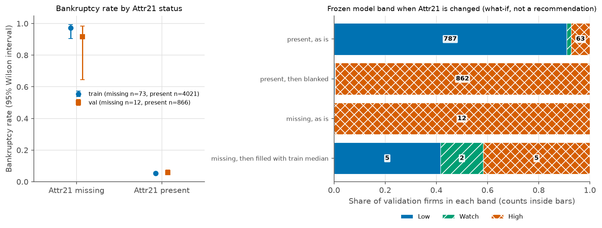

# Phase 7: Attr21 (sales growth) missingness

Generated by scripts/run_phase7_attr21.py. Train and validation only. The frozen model, calibrator and cuts are unchanged, and the test split was not read. Patterns and counts only: the dataset has no company id, year or reason for missingness.

Attr21 is defined as sales (n) / sales (n-1), so it cannot be computed without last year's sales (a property of the definition).

## 1. How many firms, and how many are bankrupt

| Split | Attr21 | Firms | Bankrupt | Rate (95% Wilson) | Share of all firms | Share of all bankrupt |
|---|---|---|---|---|---|---|
| train | missing | 73 | 71 | 0.973 (0.905 to 0.992) | 1.8% | 24.8% |
| train | present | 4021 | 215 | 0.053 (0.047 to 0.061) | 98.2% | 75.2% |
| val | missing | 12 | 11 | 0.917 (0.646 to 0.985) | 1.4% | 18.0% |
| val | present | 866 | 50 | 0.058 (0.044 to 0.075) | 98.6% | 82.0% |

## 2. What else is missing for those firms

| Split | Attributes missing per firm, Attr21 missing (median, mean) | Attributes missing per firm, Attr21 present (median, mean) | Count distribution in the missing group (attributes missing: firms) |
|---|---|---|---|
| train | 2, 3.00 | 0, 0.73 | 1: 20, 2: 33, 3: 4, 4: 7, 6: 3, 7: 1, 8: 3, 16: 1, 28: 1 |
| val | 2, 2.08 | 1, 0.82 | 1: 4, 2: 6, 3: 1, 6: 1 |

Ten other attributes whose missing rate differs most between the two groups (train):

| Attribute | Missing rate when Attr21 missing | Missing rate when Attr21 present | Difference |
|---|---|---|---|
| Attr37: (current assets - inventories) / long-term liabilities | 0.644 | 0.423 | +0.221 |
| Attr45: net profit / inventory | 0.164 | 0.042 | +0.123 |
| Attr60: sales / inventory | 0.164 | 0.042 | +0.123 |
| Attr54: constant capital / fixed assets | 0.110 | 0.016 | +0.093 |
| Attr28: working capital / fixed assets | 0.110 | 0.016 | +0.093 |
| Attr64: sales / fixed assets | 0.110 | 0.016 | +0.093 |
| Attr53: equity / fixed assets | 0.110 | 0.016 | +0.093 |
| Attr27: profit on operating activities / financial expenses | 0.123 | 0.062 | +0.061 |
| Attr61: sales / receivables | 0.027 | 0.002 | +0.026 |
| Attr14: (gross profit + interest) / total assets | 0.014 | 0.000 | +0.013 |

## 3. Are current-year sales ratios available?

Attr9 and Attr36 are sales / total assets. Among the Attr21-missing firms, counts of zero or missing (pattern only):

| Split | Firms | Attr9 equal to 0 | Attr9 missing | Attr36 equal to 0 | Attr36 missing |
|---|---|---|---|---|---|
| train | 73 | 0 | 0 | 0 | 1 |
| val | 12 | 0 | 0 | 0 | 0 |

## 4. Profile (train medians of the six most important ratios)

| Group | Firms | Attr27: profit on operating activities / financial expenses | Attr21: sales (n) / sales (n-1) | Attr34: operating expenses / total liabilities | Attr46: (current assets - inventory) / short-term liabilities | Attr25: (equity - share capital) / total assets | Attr58: total costs / total sales |
|---|---|---|---|---|---|---|---|
| bankrupt, Attr21 missing | 71 | -1.558 | n/a | 2.139 | 0.386 | -0.074 | 1.026 |
| bankrupt, Attr21 present | 215 | -1.561 | 0.916 | 1.604 | 0.496 | 0.122 | 0.999 |
| healthy, Attr21 present | 3806 | 1.021 | 1.125 | 1.705 | 1.113 | 0.442 | 0.948 |
| healthy, Attr21 missing | 2 | 0.152 | n/a | 12.608 | 292.930 | 0.547 | 1.040 |

## 5. Model performance with Attr21 present vs missing

Cuts: Watch 0.1736, High 0.2403. Bands cells show flagged firms / precision / recall within the subset. Validation cuts were fitted on validation (in-sample); train out-of-fold is the independent check. AUCs are not reported when a class has fewer than 5 firms.

| Scores | Subset | Firms | Bankrupt | PR AUC (95% CI) | ROC AUC (95% CI) | High: flagged / precision / recall | Watch+High: flagged / precision / recall |
|---|---|---|---|---|---|---|---|
| validation | Attr21 all | 878 | 61 | 0.783 (0.697 to 0.863) | 0.957 (0.931 to 0.978) | 75 / 0.600 / 0.738 | 91 / 0.538 / 0.803 |
| validation | Attr21 present | 866 | 50 | 0.713 (0.600 to 0.815) | 0.948 (0.917 to 0.972) | 63 / 0.540 / 0.680 | 79 / 0.481 / 0.760 |
| validation | Attr21 missing | 12 | 11 | n/a | n/a | 12 / 0.917 / 1.000 | 12 / 0.917 / 1.000 |
| train out-of-fold | Attr21 all | 4094 | 286 | 0.800 (0.760 to 0.839) | 0.959 (0.947 to 0.970) | 307 / 0.678 / 0.727 | 359 / 0.613 / 0.769 |
| train out-of-fold | Attr21 present | 4021 | 215 | 0.694 (0.642 to 0.748) | 0.946 (0.930 to 0.961) | 234 / 0.585 / 0.637 | 286 / 0.521 / 0.693 |
| train out-of-fold | Attr21 missing | 73 | 71 | n/a | n/a | 73 / 0.973 / 1.000 | 73 / 0.973 / 1.000 |

High band composition:

| Scores | High firms | with Attr21 missing (bankrupt) | with Attr21 present (bankrupt) |
|---|---|---|---|
| validation | 75 | 12 (11) | 63 (34) |
| train out-of-fold | 307 | 73 (71) | 234 (137) |

Phase 2 ablation (model retrained without Attr21, quoted from reports/models_val.md (Phase 2, not rerun)): validation PR AUC 0.687 against 0.783 with all features.

## 6. What-if on the frozen model (validation)

Attr21 changed for the model input only. The train median used for filling is 1.1160. This describes how the frozen model behaves. It is not a recommendation to impute.

| Change | Firms | Low before to after | Watch before to after | High before to after | Firms that change band | Mean change, calibrated log-odds |
|---|---|---|---|---|---|---|
| Attr21 present, set to missing | 866 | 787 to 3 | 16 to 1 | 63 to 862 | 800 | +5.77 |
| Attr21 missing, set to train median | 12 | 0 to 5 | 0 to 2 | 12 to 5 | 7 | -5.01 |

## Flags

1. Attr21 is missing for 73 train and 12 validation firms, and 71 and 11 of them are bankrupt. Those firms are 24.8% (train) and 18.0% (validation) of all bankrupt firms. In this data, a missing Attr21 almost always goes with a bankrupt label. The cause is not known.
2. The validation group is only 12 firms (1 healthy), so anything measured on it is very noisy. Train has the larger group but the model was fit on it, so out-of-fold scores are used for the train performance numbers.
3. High band composition on validation: 12 of 75 High firms have Attr21 missing; on train out-of-fold: 73 of 307.
4. On firms with Attr21 present, validation PR AUC is 0.713 (0.600 to 0.815) against 0.783 (0.697 to 0.863) for all firms, and train out-of-fold PR AUC is 0.694 against 0.800. The Phase 2 retrain without Attr21 scored 0.687 against 0.783 with it.
5. What-if on the frozen model (validation): blanking Attr21 for the 866 firms that have it moves 800 firms to a different band (mean change +5.77 calibrated log-odds). Filling the 12 missing firms with the train median moves 7 firms (mean change -5.01). A user who leaves Attr21 blank gets the model's missing-value behaviour, not a neutral score.
6. Co-missingness (train): Attr21-missing firms have a median of 2 attributes missing (mean 3.00, pulled up by a few firms with many missing), against a median of 0 (mean 0.73) for the others. The distribution is in the table.
7. For firms with Attr21 present, High-band precision is 0.540 on validation and 0.585 on train out-of-fold, against 0.600 and 0.678 for all firms. The headline numbers are flattered by the small group where a missing value goes with the bankrupt label.
8. The dataset has no company id and no year, and no field says why a value is missing. This report states counts and patterns only.
9. The test split cannot be broken down by Attr21 status without reading it again, so no such breakdown exists. The Phase 5 test results are unchanged and already include whatever reliance on Attr21 the model has.
10. Out-of-fold scores use the saved Platt calibrator that was fitted on those same out-of-fold scores, so the calibrated train numbers are mildly optimistic.
11. Test split untouched in this phase. No model, calibrator or cut was changed.
