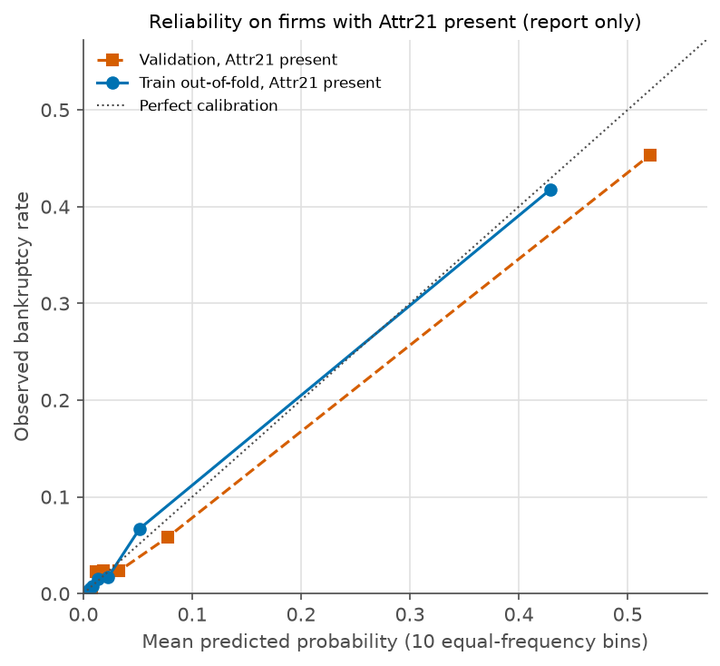

# Phase 8 prep: app numbers, blank-attribute report and demo firms

Generated by scripts/run_phase8_prep.py. Train and validation only, frozen model, calibrator and cuts unchanged, test split not read. Rules were fixed in docs/decisions.md (Phase 8 protocol) before this ran.

## 1. Performance on firms with Attr21 present, beside all firms

Cuts: Watch 0.1736, High 0.2403. No-skill PR AUC is the share of bankrupt firms in the subset. Validation cuts were fitted on validation (in-sample), train out-of-fold is the independent check.

| Scores | Subset | Firms | Bankrupt | No-skill PR AUC | PR AUC (95% CI) | ROC AUC (95% CI) | High precision (95% CI) | High recall (95% CI) | Watch+High recall (95% CI) |
|---|---|---|---|---|---|---|---|---|---|
| validation | Attr21 present | 866 | 50 | 0.058 | 0.713 (0.600 to 0.815) | 0.948 (0.917 to 0.972) | 0.540 (0.446 to 0.648) | 0.680 (0.540 to 0.800) | 0.760 (0.640 to 0.880) |
| validation | All firms | 878 | 61 | 0.069 | 0.783 (0.697 to 0.863) | 0.957 (0.931 to 0.978) | 0.600 (0.519 to 0.690) | 0.738 (0.623 to 0.852) | 0.803 (0.705 to 0.902) |
| train out-of-fold | Attr21 present | 4021 | 215 | 0.053 | 0.694 (0.642 to 0.748) | 0.946 (0.930 to 0.961) | 0.585 (0.532 to 0.640) | 0.637 (0.572 to 0.702) | 0.693 (0.633 to 0.754) |
| train out-of-fold | All firms | 4094 | 286 | 0.070 | 0.800 (0.760 to 0.839) | 0.959 (0.947 to 0.970) | 0.678 (0.633 to 0.723) | 0.727 (0.675 to 0.780) | 0.769 (0.720 to 0.822) |

Attr21 missing: 12 validation firms (11 bankrupt) and 73 train firms (71 bankrupt). The all-firms figures include them, which flatters them.

## 2. Historical bankrupt rate per band, firms with Attr21 present

| Scores | Band | Firms | Bankrupt | Rate (95% Wilson) |
|---|---|---|---|---|
| validation | Low | 787 | 12 | 0.015 (0.009 to 0.026) |
| validation | Watch | 16 | 4 | 0.250 (0.102 to 0.495) |
| validation | High | 63 | 34 | 0.540 (0.418 to 0.657) |
| train out-of-fold | Low | 3735 | 66 | 0.018 (0.014 to 0.022) |
| train out-of-fold | Watch | 52 | 12 | 0.231 (0.137 to 0.361) |
| train out-of-fold | High | 234 | 137 | 0.585 (0.521 to 0.647) |

## 3. Calibration on firms with Attr21 present (report only)

| Scores | Mean predicted | Observed rate | ECE (95% CI) |
|---|---|---|---|
| validation | 0.0680 | 0.0577 | 0.0134 (0.0082 to 0.0257) |
| train out-of-fold | 0.0543 | 0.0535 | 0.0042 (0.0029 to 0.0101) |

## 4. Blank attributes in train and validation

Rule fixed before looking: with Attr21 present, more than 6 of the other 63 attributes blank blocks scoring. Counts only. Features are blank in the raw data and the app would score them with LightGBM's native handling, with a warning.

| Split | Firms | Attr21 blank (not scored) | Attr21 present | With any other blank | Share | Over the limit (blocked) | Bankrupt among those |
|---|---|---|---|---|---|---|---|
| train | 4094 | 73 | 4021 | 1889 | 47.0% | 39 | 4 |
| val | 878 | 12 | 866 | 440 | 50.8% | 10 | 2 |

Distribution of other blank attributes per firm (Attr21 present):

- train: 0 blank: 2132 firms, 1 blank: 1470 firms, 2 blank: 199 firms, 3 blank: 99 firms, 4 blank: 38 firms, 5 blank: 28 firms, 6 blank: 16 firms, 7 blank: 18 firms, 8 blank: 7 firms, 9 blank: 4 firms, 12 blank: 1 firms, 14 blank: 4 firms, 15 blank: 2 firms, 19 blank: 1 firms, 20 blank: 1 firms, 32 blank: 1 firms
- val: 0 blank: 426 firms, 1 blank: 341 firms, 2 blank: 48 firms, 3 blank: 24 firms, 4 blank: 7 firms, 5 blank: 8 firms, 6 blank: 2 firms, 7 blank: 3 firms, 8 blank: 2 firms, 14 blank: 3 firms, 20 blank: 2 firms

Attributes with blanks, Attr21-present firms (train and validation):

| Attribute | Train blank firms (rate) | Validation blank firms (rate) |
|---|---|---|
| Attr37: (current assets - inventories) / long-term liabilities | 1699 (0.423) | 385 (0.445) |
| Attr27: profit on operating activities / financial expenses | 251 (0.062) | 62 (0.072) |
| Attr45: net profit / inventory | 168 (0.042) | 44 (0.051) |
| Attr60: sales / inventory | 168 (0.042) | 44 (0.051) |
| Attr24: gross profit (in 3 years) / total assets | 90 (0.022) | 22 (0.025) |
| Attr54: constant capital / fixed assets | 66 (0.016) | 12 (0.014) |
| Attr28: working capital / fixed assets | 66 (0.016) | 12 (0.014) |
| Attr64: sales / fixed assets | 66 (0.016) | 12 (0.014) |
| Attr53: equity / fixed assets | 66 (0.016) | 12 (0.014) |
| Attr41: total liabilities / ((profit on operating activities + depreciation) * (12/365)) | 57 (0.014) | 17 (0.020) |
| Attr32: (current liabilities * 365) / cost of products sold | 34 (0.008) | 4 (0.005) |
| Attr52: (short-term liabilities * 365) / cost of products sold | 26 (0.006) | 4 (0.005) |
| Attr47: (inventory * 365) / cost of products sold | 25 (0.006) | 4 (0.005) |
| Attr63: sales / short-term liabilities | 11 (0.003) | 6 (0.007) |
| Attr40: (current assets - inventory - receivables) / short-term liabilities | 11 (0.003) | 6 (0.007) |
| Attr33: operating expenses / short-term liabilities | 11 (0.003) | 6 (0.007) |
| Attr46: (current assets - inventory) / short-term liabilities | 11 (0.003) | 6 (0.007) |
| Attr12: gross profit / short-term liabilities | 11 (0.003) | 6 (0.007) |
| Attr4: current assets / short-term liabilities | 11 (0.003) | 6 (0.007) |
| Attr34: operating expenses / total liabilities | 9 (0.002) | 5 (0.006) |
| Attr8: book value of equity / total liabilities | 9 (0.002) | 5 (0.006) |
| Attr17: total assets / total liabilities | 9 (0.002) | 5 (0.006) |
| Attr16: (gross profit + depreciation) / total liabilities | 9 (0.002) | 5 (0.006) |
| Attr5: [(cash + short-term securities + receivables - short-term liabilities) / (operating expenses - depreciation)] * 365 | 9 (0.002) | 2 (0.002) |
| Attr26: (net profit + depreciation) / total liabilities | 9 (0.002) | 5 (0.006) |
| Attr50: current assets / total liabilities | 9 (0.002) | 5 (0.006) |
| Attr61: sales / receivables | 7 (0.002) | 3 (0.003) |
| Attr15: (total liabilities * 365) / (gross profit + depreciation) | 3 (0.001) | 3 (0.003) |
| Attr1: net profit / total assets | 1 (0.000) | 0 (0.000) |
| Attr22: profit on operating activities / total assets | 1 (0.000) | 0 (0.000) |
| Attr48: EBITDA (profit on operating activities - depreciation) / total assets | 1 (0.000) | 0 (0.000) |
| Attr6: retained earnings / total assets | 1 (0.000) | 0 (0.000) |
| Attr10: equity / total assets | 1 (0.000) | 0 (0.000) |
| Attr14: (gross profit + interest) / total assets | 1 (0.000) | 0 (0.000) |
| Attr59: long-term liabilities / equity | 1 (0.000) | 0 (0.000) |
| Attr35: profit on sales / total assets | 1 (0.000) | 0 (0.000) |
| Attr18: gross profit / total assets | 1 (0.000) | 0 (0.000) |
| Attr57: (current assets - inventory - short-term liabilities) / (sales - gross profit - depreciation) | 1 (0.000) | 0 (0.000) |
| Attr36: total sales / total assets | 1 (0.000) | 0 (0.000) |
| Attr38: constant capital / total assets | 1 (0.000) | 0 (0.000) |
| Attr11: (gross profit + extraordinary items + financial expenses) / total assets | 1 (0.000) | 0 (0.000) |
| Attr25: (equity - share capital) / total assets | 1 (0.000) | 0 (0.000) |
| Attr51: short-term liabilities / total assets | 1 (0.000) | 0 (0.000) |
| Attr2: total liabilities / total assets | 1 (0.000) | 0 (0.000) |
| Attr3: working capital / total assets | 1 (0.000) | 0 (0.000) |
| Attr7: EBIT / total assets | 1 (0.000) | 0 (0.000) |
| Attr29: logarithm of total assets | 1 (0.000) | 0 (0.000) |

Descriptive history for attributes blank in at least 20 Attr21-present train firms (not a test of the effect):

| Attribute | Train: bankrupt when blank | Train: when present | Validation: bankrupt when blank | Validation: when present | Mean contribution when blank (train) | When present (train) |
|---|---|---|---|---|---|---|
| Attr24 | 0 of 90 (0.000) | 0.055 | 0 of 22 (0.000) | 0.059 | -1.01 | +0.03 |
| Attr27 | 69 of 251 (0.275) | 0.039 | 20 of 62 (0.323) | 0.037 | +2.31 | -0.22 |
| Attr28 | 4 of 66 (0.061) | 0.053 | 3 of 12 (0.250) | 0.055 | -0.17 | +0.00 |
| Attr32 | 1 of 34 (0.029) | 0.054 | 0 of 4 (0.000) | 0.058 | +0.06 | +0.01 |
| Attr37 | 95 of 1699 (0.056) | 0.052 | 25 of 385 (0.065) | 0.052 | -0.04 | +0.03 |
| Attr41 | 0 of 57 (0.000) | 0.054 | 0 of 17 (0.000) | 0.059 | -0.88 | +0.01 |
| Attr45 | 15 of 168 (0.089) | 0.052 | 3 of 44 (0.068) | 0.057 | +0.13 | -0.01 |
| Attr47 | 0 of 25 (0.000) | 0.054 | 0 of 4 (0.000) | 0.058 | -0.25 | -0.00 |
| Attr52 | 0 of 26 (0.000) | 0.054 | 0 of 4 (0.000) | 0.058 | -0.08 | +0.00 |
| Attr53 | 4 of 66 (0.061) | 0.053 | 3 of 12 (0.250) | 0.055 | -0.07 | -0.00 |
| Attr54 | 4 of 66 (0.061) | 0.053 | 3 of 12 (0.250) | 0.055 | -0.10 | +0.01 |
| Attr60 | 15 of 168 (0.089) | 0.052 | 3 of 44 (0.068) | 0.057 | +0.12 | -0.01 |
| Attr64 | 4 of 66 (0.061) | 0.053 | 3 of 12 (0.250) | 0.055 | -0.24 | +0.01 |

## 5. Demo firms (Phase 6 rule, restricted to Attr21-present validation firms)

Phase 6 rule restricted to Attr21-present validation firms: highest-scoring true positive, highest-scoring false alarm, highest-scoring bankrupt firm below the Watch cut. Rows are from the validation split of the Polish 5year data (UCI, CC BY 4.0), identified by row number, with no company id.

| Role | Validation row | Dataset label | Model probability | Band | Other blanks | Would be scored |
|---|---|---|---|---|---|---|
| highest scoring true positive | 831 | bankrupt within the year | 0.990 | High | 1 | True |
| highest scoring false alarm | 571 | still operating | 0.798 | High | 1 | True |
| nearest miss below watch cut | 319 | bankrupt within the year | 0.163 | Low | 0 | True |

## Flags

1. Blanks in other attributes can carry signal too. In train, a blank Attr27 adds more than 1.0 calibrated log-odds on average to that attribute's contribution. The app's warning therefore also shows the train and validation history for each blank attribute. 2 of the 3 demo firms have a blank attribute. This is descriptive and is not a test of the effect.
2. A blank-attribute warning will appear for about half of scorable firms: 47.0% of train and 50.8% of validation firms with Attr21 present have at least one other blank, most often Attr37 (42.3% of train firms). The limit of 6 would block 39 train and 10 validation firms. The effect of these blanks on the score is untested.
3. The cuts were set on all firms. High precision on firms with Attr21 present is 0.540 on validation and 0.585 on train out-of-fold, against 0.600 and 0.678 for all firms, and the band rule's floor is 0.60. Nothing was re-cut or recalibrated.
4. Calibration on firms with Attr21 present is report only: mean predicted probability 0.0680 against an observed rate of 0.0577 on validation, and 0.0543 against 0.0535 on train out-of-fold. ECE is 0.0134 (0.0082 to 0.0257) on validation and 0.0042 (0.0029 to 0.0101) out-of-fold. Bootstrap ECE is biased upward on small data, so the point estimate can sit outside its own interval.
5. Validation Watch band on firms with Attr21 present has 16 firms, so its rate carries very little information.
6. Train out-of-fold scores use the saved Platt calibrator that was fitted on those same scores, so the out-of-fold calibration numbers are mildly optimistic.
7. The validation cuts were fitted on validation, so validation precision and recall at the cuts are in-sample. Train out-of-fold is the independent check.
8. Sector composition of the Polish data is not stated on the UCI page, so the sector is UNVERIFIED. The data is a random split, with no company id or year.
9. Test split untouched in this phase. No model, calibrator or cut was changed.
